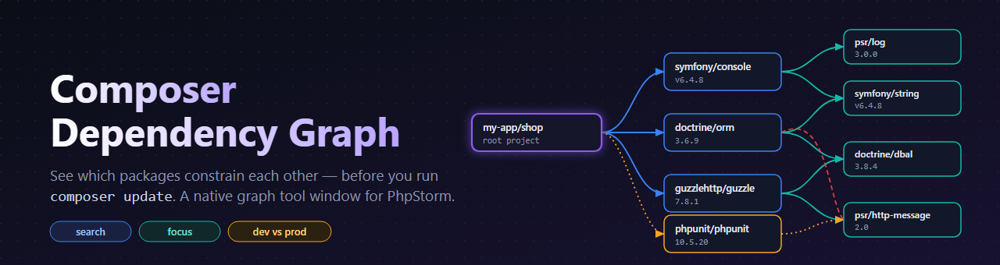
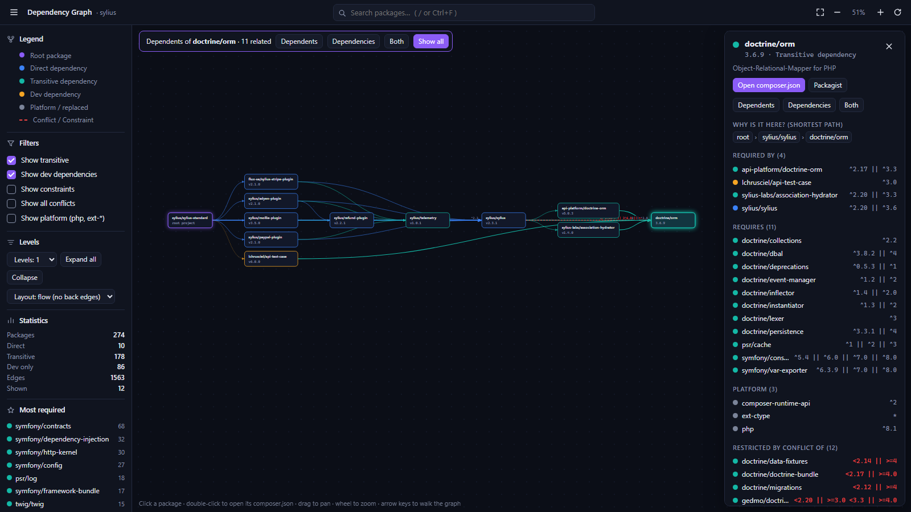
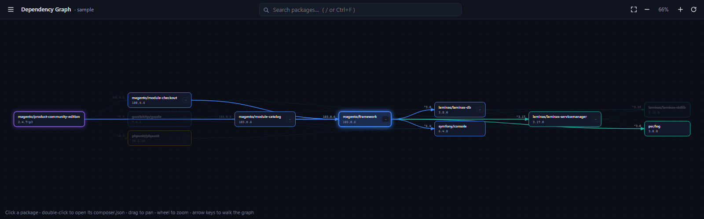
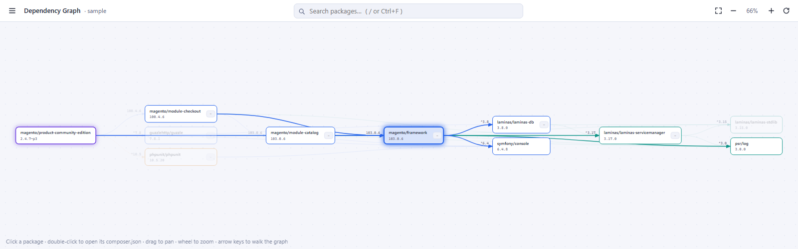

<p align="center">
  
</p>

# Composer Dependency Graph for PhpStorm

An interactive, searchable graph of your project's Composer dependencies — right inside PhpStorm.

A project with dozens of third-party packages quickly accumulates hundreds of transitive dependencies. If you
don't know which packages constrain each other, a `composer update` turns into trial and error. This plugin makes
that graph visible: **who requires what, with which version constraint, and why a package is installed at all.**



## Features

- **Graph from your lock file** – reads `composer.lock` (falls back to `vendor/composer/installed.json`, then `composer.json`).
- **Colour-coded nodes** – root, direct, transitive, dev-only, platform (`php`, `ext-*`), replaced and not-installed packages.
- **Constraints on the edges** – see `^3.17`, `>=8.1` … exactly where a package is required. Conflicts are shown as red dashed edges.
- **Search** – `/` or `Ctrl+F`, live results, arrow keys + Enter. Packages hidden by a collapsed branch are revealed automatically.
- **"Why is this installed?"** – the shortest path from your root package to the selected package.
- **Focus mode** – show only the *dependents* (who needs it), the *dependencies* (what it needs), or both.
- **Scales to big projects** – levels, expand/collapse per node, "Most required" list, filters for transitive / dev / platform.
- **Open the package** – double-click (or Enter) opens `vendor/<package>/composer.json`; one click to Packagist.
- **Stays up to date** – reloads when `composer.lock` changes. Multiple `composer.json` projects in one repo are supported.
- **Light and dark themes** – follows the IDE theme.

| Small project, constraints on | Light theme |
|---|---|
|  |  |

## Requirements

- PhpStorm **2024.2 or newer** (build `242+`) with the embedded browser (JCEF). Tested against PhpStorm 2024.2.6; other JetBrains IDEs are untested.
- A project with a `composer.json`. Run `composer install` first for the full graph (the plugin needs `composer.lock`).

The plugin only uses the IntelliJ Platform, so it does not depend on the PHP plugin.

## Install

**From a release (recommended)**

1. Download `composer-dependency-graph-<version>.zip` from the [Releases](../../releases) page.
2. In PhpStorm: **Settings → Plugins → ⚙ → Install Plugin from Disk…** and pick the zip. Restart if asked.

**From source**

```bash
./gradlew buildPlugin
# -> build/distributions/composer-dependency-graph-<version>.zip
```

then install the zip as above.

## Usage

Open the **Composer Graph** tool window (right-hand stripe), or use **Tools → Show Composer Dependency Graph**.
You can also right-click `composer.json` / `composer.lock` in the project view or editor. With the caret on a
`"vendor/package"` string in `composer.json`, that package is selected in the graph.

Quick reference:

| Action | How |
|---|---|
| Search | `/` or `Ctrl+F`, `↑` `↓`, `Enter` |
| Select / highlight relations | click a package |
| Open its `composer.json` | double-click or `Enter` |
| Walk the graph | `←` dependent · `→` dependency · `↑` `↓` neighbours |
| Expand / collapse a node | chevron on the node, or `Space` |
| Pan / zoom | drag / wheel, `+` `-`, `0` = fit |
| Back to previous selection | `Alt+←` or **← Back** in the details panel |
| Leave focus mode / clear selection | `Esc` |

See **[docs/HELP.md](docs/HELP.md)** for the full guide (reading the graph, filters, layouts, troubleshooting).

## Development

```bash
./gradlew buildPlugin        # build the zip
./gradlew verifyPlugin       # run the Plugin Verifier against the IDE in `phpStormPath`
./gradlew runIde             # start a sandbox IDE with the plugin
```

`phpStormPath` in `gradle.properties` points at the local PhpStorm the plugin is compiled against – change it to
your own installation (or switch the `local(...)` line in `build.gradle.kts` to `phpstorm("2024.2.6")` to download one).

The UI is plain HTML/CSS/JS in `src/main/resources/web/` and runs without the IDE:

```bash
node dev/preview.mjs <composer-project-dir> [dark|light]   # writes dev/preview.html
node dev/serve.mjs                                          # http://localhost:5173
```

`dev/sample/` contains a tiny Composer project to try this on. Kotlin code (`src/main/kotlin`) only reads the
Composer files, hosts the JCEF browser and bridges IDE actions (open file, reload, persist filters).

## How it works

`composer.lock` is parsed into nodes (packages) and edges (`require`, `require-dev`, `conflict`). `replace` and
`provide` entries are resolved so requirements on virtual or replaced packages point at the right node. Packages
are classified by reachability from the root: *direct*, *transitive* (reachable through `require`) or *dev* (only
reachable through `require-dev`). The layout is a layered, left-to-right drawing with barycenter ordering to
reduce edge crossings.

## License

[MIT](LICENSE) © Issam Feddi
